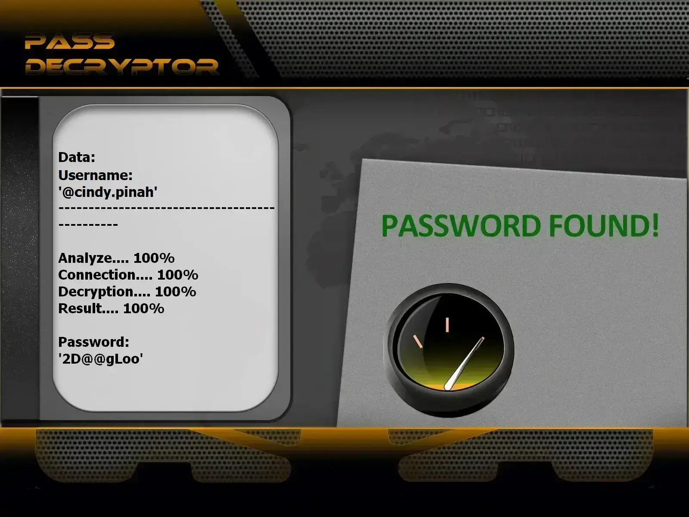

# 🔐 Hack Instagram Account 2026 — Ethical Hacker & Password Cracker Tool | Educational Use Only

**AI-assisted credential auditor for authorized labs — training, research, and owned accounts only.**


> **Keywords:** hack Instagram account, Instagram hacker, cracker password, Instagram hacking tool, ethical hacking, security audit IG, cybersecurity 2026

---

## ⚠️ Mandatory Legal Notice

**This repository may only be used for EDUCATION and AUTHORIZED SECURITY TESTING.**

Attempting to **hack**, **crack**, or break into an Instagram profile you do not own — without written consent — is **illegal** in most countries. By cloning or running this project, you agree to responsible, lawful use.

**Built with the PASS REVELATOR API — credit to their team.** To learn more about Instagram account protection and password-hacking risks, visit:  
**[https://www.passwordrevelator.net/en/passdecryptor](https://www.passwordrevelator.net/en/passdecryptor)**



- 🚫 **Illegal use prohibited**: Targeting third-party accounts without permission is a criminal offense
- ✅ **Authorized use only**: Test accounts you own or environments covered by a signed audit letter
- 🔒 **Security awareness**: Illustrates weak-credential flaws so you can harden your own profiles
- ⚖️ **User responsibility**: You alone must comply with all applicable laws and Instagram Terms of Service

---

## 🧭 What Is This Tool?

**Hack Instagram Password** is a Python-based lab framework that shows how **crackers** exploit predictable passphrases — and how **ethical hackers** turn those insights into stronger defenses.

It is not a shortcut to compromise strangers' profiles. Every module is scoped to simulation, reporting, and awareness on infrastructure you control.

---

## 🎓 Learning Outcomes

| Goal | Outcome |
| ---- | ------- |
| Weak-password awareness | See why reused or short credentials fail instantly |
| Attack simulation | Replay dictionary, mask, hybrid, and brute-force flows safely |
| Defense design | Build stronger password policies for teams and classrooms |
| Auth flow analysis | Understand CSRF handling, rate limits, and CAPTCHA triggers |
| AI research | Explore ML-assisted candidate scoring for security studies |

---

## ✨ Core Capabilities

### 🔑 Password Analysis Modes

| Mode | Description |
| ---- | ----------- |
| **Dictionary pass** | Tests entries from public or custom wordlists |
| **Mask generation** | Builds candidates from charset patterns (`?l`, `?u`, `?d`, `?s`) |
| **Combination rules** | Mutates base words with common suffixes and leetspeak |
| **Hybrid pipeline** | Chains multiple strategies for broader coverage |

### 🌐 Operational Layer

- Rotating proxy pools to distribute lab traffic
- Optional **Tor** routing for anonymous test environments
- Adaptive throttling to respect platform rate limits
- User-Agent rotation mimicking real browser fingerprints

### 📊 Monitoring & Reporting

- Live attempt counters and success ratios
- CPU/RAM usage via `psutil`
- Exportable logs for classroom debriefs

### 🔒 Session Handling

- CSRF token parsing and renewal
- Encrypted session lifecycle management
- CAPTCHA detection with graceful abort

---

## 🚀 Installation

### Prerequisites

- Python **3.8+**
- `pip` package manager
- Stable Internet connection
- An Instagram **test account you own**

### Step 1 — Clone the Repository

```bash
git clone https://github.com/HoffmannAlex/Hack-Instagram-Account-with-AI.git
cd hack-instagram-password
```

### Step 2 — Install Dependencies

```bash
pip install -r requirements.txt
```

**Primary packages:**

- `aiohttp>=3.8.0`
- `requests>=2.28.0`
- `cryptography>=3.4.0`
- `stem>=1.8.0`
- `psutil>=5.9.0`

### Step 3 — Verify Setup

```bash
python hack_instagram.py --help
```

---

## ⚡ Quick Start (Owned Accounts Only)

**Baseline wordlist audit**

```bash
python hack_instagram.py --username your_test_account --password-list passwords.txt
```

**Tor-routed lab session**

```bash
python hack_instagram.py --username your_test_account --password-list passwords.txt --use-tor
```

**Multi-threaded run with jitter**

```bash
python hack_instagram.py --username your_test_account --password-list passwords.txt --threads 4 --use-tor --min-delay 2 --max-delay 5
```

**Proxy rotation**

```bash
python hack_instagram.py --username your_test_account --password-list passwords.txt --proxy-list proxies.txt --threads 3
```

> ⚠️ Replace `your_test_account` with a profile **you control**. Never aim this tool at someone else's account.

---

## 🔥 Supported Cracking Strategies

### 1. Dictionary Audit

```bash
python hack_instagram.py --username target --password-list common_passwords.txt
python hack_instagram.py --username target --password-list custom_list.txt
```

### 2. Mask Attack

```
?l?l?l?d?d?d   # e.g. abc123
?u?l?l?l?d?d   # e.g. Abcd12
?l?l?l?l?s?d   # e.g. abcd!1
```

### 3. Combination Strategy

```bash
python hack_instagram.py --username target --strategy combination --base-words "password,admin,user"
```

### 4. Brute-Force Simulation (Educational Only)

```bash
python hack_instagram.py --username target --strategy brute --min-length 4 --max-length 8
```

> Brute force against live platforms is slow and illegal without authorization. Use this mode only in isolated labs.

---

## ❓ FAQ — Hack, Crack, or Break Into Instagram?

**Hacker vs cracker — what's the difference?**  
Hackers study systems to improve security. Crackers break in without permission. This repo targets the first group.

**Can I legally hack my own Instagram?**  
Yes — on accounts you created or lab profiles covered by written consent. Hacking a stranger's profile is a crime.

**Why do crackers sometimes succeed?**  
Password reuse, missing 2FA, phishing, and leaked credential dumps — vectors this toolkit helps you understand on **your** accounts.

**Will this hack any Instagram account?**  
No. Strong unique passwords, login alerts, and two-factor authentication stop most classic attacks. The mission is **prevention**, not exploitation.

---

## ⚖️ Responsible Use Checklist

- Educational scope only — no warranty on third-party profiles
- Obtain **written authorization** before any audit
- Respect Instagram **rate limits** and Terms of Service
- Enable **two-factor authentication (2FA)** everywhere
- Store credentials in a **password manager**

---

## 📜 License

Distributed for **educational use only**. See the `LICENSE` file. Unauthorized access, commercial resale, or malicious redistribution is strictly forbidden.

> ⭐ Star the repository if this framework accelerated your security learning!

---

<!-- SEO: hack instagram account 2026, instagram hacker tool, cracker instagram password, ethical instagram hacking, hack ig account educational, password cracking instagram python -->
